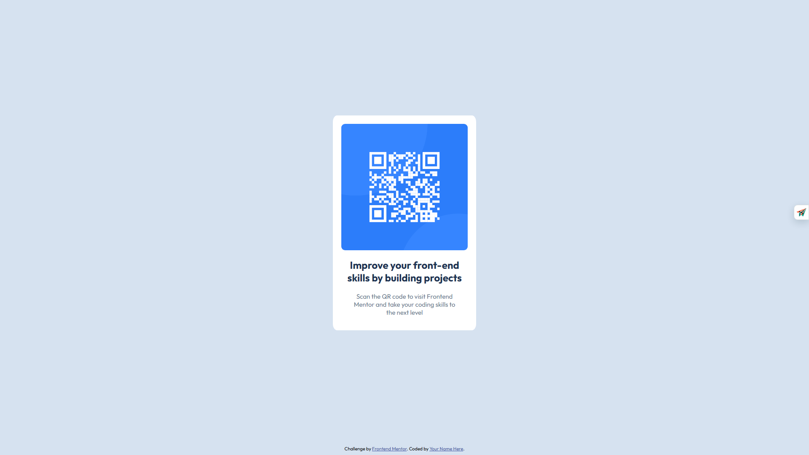

# Frontend Mentor - QR code component solution

This is a solution to the [QR code component challenge on Frontend Mentor](https://www.frontendmentor.io/challenges/qr-code-component-iux_sIO_H). Frontend Mentor challenges help you improve your coding skills by building realistic projects. 

## Table of contents

- [Overview](#overview)
  - [Screenshot](#screenshot)
  - [Links](#links)
- [My process](#my-process)
  - [Built with](#built-with)
  - [What I learned](#what-i-learned)
  - [Continued development](#continued-development)
- [Author](#author)

**Note: Delete this note and update the table of contents based on what sections you keep.**

## Overview

### Screenshot

### Links

- Solution URL: (https://github.com/new-git-stack/qr-code-component-main)
- Live Site URL: (https://jovial-scone-80fd8f.netlify.app/)

## My process

### Built with

- HTML5
- CSS

### Continued development

I feel like the way I went about doing the might not be the best but it works in this case.

## Author

- Website - Obeten Samuel (https://jovial-scone-80fd8f.netlify.app/)
- Frontend Mentor - [@new-git-stack](https://www.frontendmentor.io/profile/new-git-stack)

